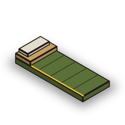
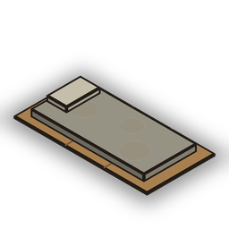
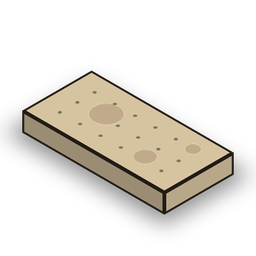
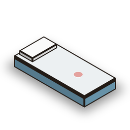
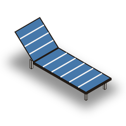
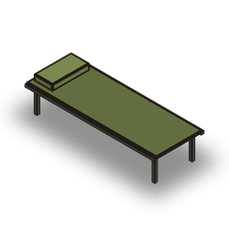
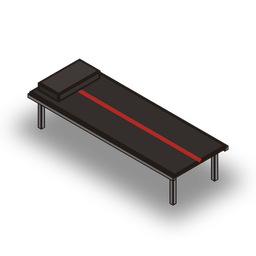
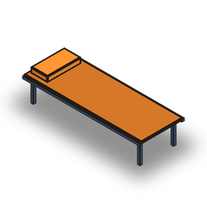
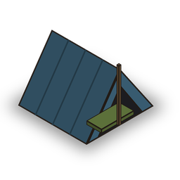
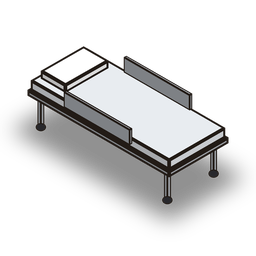

# apoc_camas

Camas fabricables para servidores **QBCore**. El jugador fabrica una cama, la coloca en el mundo y, al entrar al servidor, elige en cuál despertar. Para eso tiene un selector con vista previa de cámara sobre cada cama.

## Qué incluye

- **10 camas** que son props reales de GTA V, cada una con su objeto, su imagen y su receta.
- **Colocación con vista previa:** un "fantasma" de la cama sigue a la cámara y se pone verde si el sitio es válido y rojo si no.
  - `E` coloca la cama.
  - La rueda del ratón o `←` `→` la giran.
  - `Retroceso` cancela.
- **Recoger la cama** con `E`, y vuelve al inventario. Opcionalmente, otros jugadores pueden destruirla (`Config.AllowDestroy`).
- **Selector de aparición** al elegir personaje (sustituye a `qb-spawn`):
  - Muestra todas tus camas, tu última ubicación y los puntos públicos (por ejemplo, el refugio).
  - Te mueves de izquierda a derecha con `←` `→`, `A`/`D` o con el ratón.
  - La cámara gira alrededor de la cama elegida para que veas exactamente dónde está.
  - `Enter` despierta allí.
- **Banco de trabajo** para fabricar las camas con materiales.
- Las camas se guardan en la base de datos (la tabla se crea sola) y las ven todos los jugadores.

## Las 10 camas

Las imágenes son ilustraciones para el inventario y el menú. En el juego se coloca el modelo real de GTA V indicado en la tabla. Puedes ver ese modelo en 3D en el enlace, o en el juego con `/vercamas`.

| Imagen | Cama | Modelo de GTA V | Objeto | Receta |
|---|---|---|---|---|
|  | **Saco de dormir** | `prop_skid_sleepbag_1` ([ver modelo 3D](https://forge.plebmasters.de/objects/prop_skid_sleepbag_1)) | `cama_saco` | Plástico x10, Goma x5 |
|  | **Colchón de cartones** | `prop_homeless_matress_01` ([ver modelo 3D](https://forge.plebmasters.de/objects/prop_homeless_matress_01)) | `cama_colchon_sucio` | Plástico x8, Chatarra x5 |
|  | **Colchón viejo** | `prop_rub_matress_01` ([ver modelo 3D](https://forge.plebmasters.de/objects/prop_rub_matress_01)) | `cama_colchon` | Plástico x12, Acero x4, Goma x4 |
|  | **Colchón de hospital** | `v_med_mattress` ([ver modelo 3D](https://forge.plebmasters.de/objects/v_med_mattress)) | `cama_colchon_hospital` | Plástico x15, Goma x8, Acero x3 |
|  | **Tumbona** | `prop_patio_lounger1` ([ver modelo 3D](https://forge.plebmasters.de/objects/prop_patio_lounger1)) | `cama_tumbona` | Aluminio x12, Plástico x10 |
|  | **Catre militar** | `gr_prop_gr_campbed_01` ([ver modelo 3D](https://forge.plebmasters.de/objects/gr_prop_gr_campbed_01)) | `cama_catre_militar` | Acero x8, Plástico x10, Aluminio x5 |
|  | **Catre de motero** | `bkr_prop_biker_campbed_01` ([ver modelo 3D](https://forge.plebmasters.de/objects/bkr_prop_biker_campbed_01)) | `cama_catre_motero` | Acero x8, Goma x10, Hierro x5 |
|  | **Catre de taller** | `imp_prop_impexp_campbed_01` ([ver modelo 3D](https://forge.plebmasters.de/objects/imp_prop_impexp_campbed_01)) | `cama_catre_taller` | Aluminio x10, Plástico x10, Hierro x5 |
|  | **Tienda improvisada** | `prop_skid_tent_01` ([ver modelo 3D](https://forge.plebmasters.de/objects/prop_skid_tent_01)) | `cama_tienda` | Plástico x20, Chatarra x10, Goma x5 |
|  | **Camilla de hospital** | `v_med_emptybed` ([ver modelo 3D](https://forge.plebmasters.de/objects/v_med_emptybed)) | `cama_camilla` | Acero x15, Aluminio x8, Goma x6, Plástico x10 |

Los materiales son objetos estándar de QBCore. Las misiones de `apoc_misiones`, sobre todo **Chatarrería**, dan muchos de ellos.

## Requisitos

- `qb-core`, `qb-menu`, `oxmysql`
- OneSync activado
- `qb-multicharacter`, o cualquier multipersonaje que use los eventos de `qb-spawn`

## Instalación

1. Copia la carpeta `apoc_camas` en `resources`.
2. En `server.cfg`, **quita o comenta `ensure qb-spawn`**, porque este recurso lo sustituye. Después añade, debajo de `qb-core`, `qb-menu` y `oxmysql`:
   ```
   ensure apoc_camas
   ```
3. Copia las imágenes `html/images/cama_*.png` en `qb-inventory/html/images/`, para que se vean en el inventario.
4. **Objetos:** se registran solos al arrancar si tu `qb-core` es reciente (`Config.AutoRegisterItems`). Si en la consola aparece el aviso `No se pudieron registrar automáticamente`, pega esto dentro de `QBShared.Items` en `qb-core/shared/items.lua`:
   ```lua
    cama_saco = { name = 'cama_saco', label = 'Saco de dormir', weight = 2000, type = 'item', image = 'cama_saco.png', unique = false, useable = true, shouldClose = true, description = 'Ligero y fácil de esconder. Duerme donde sea.' },
    cama_colchon_sucio = { name = 'cama_colchon_sucio', label = 'Colchón de cartones', weight = 3000, type = 'item', image = 'cama_colchon_sucio.png', unique = false, useable = true, shouldClose = true, description = 'Un colchón viejo sobre cartones. Barato, pero cumple.' },
    cama_colchon = { name = 'cama_colchon', label = 'Colchón viejo', weight = 4000, type = 'item', image = 'cama_colchon.png', unique = false, useable = true, shouldClose = true, description = 'Manchado y con muelles, pero mejor que el suelo.' },
    cama_colchon_hospital = { name = 'cama_colchon_hospital', label = 'Colchón de hospital', weight = 4000, type = 'item', image = 'cama_colchon_hospital.png', unique = false, useable = true, shouldClose = true, description = 'Rescatado de un hospital abandonado.' },
    cama_tumbona = { name = 'cama_tumbona', label = 'Tumbona', weight = 4000, type = 'item', image = 'cama_tumbona.png', unique = false, useable = true, shouldClose = true, description = 'Una tumbona de jardín. Dormir al aire libre con estilo.' },
    cama_catre_militar = { name = 'cama_catre_militar', label = 'Catre militar', weight = 5000, type = 'item', image = 'cama_catre_militar.png', unique = false, useable = true, shouldClose = true, description = 'Catre plegable del ejército. Resistente y aislado del suelo.' },
    cama_catre_motero = { name = 'cama_catre_motero', label = 'Catre de motero', weight = 5000, type = 'item', image = 'cama_catre_motero.png', unique = false, useable = true, shouldClose = true, description = 'Sacado de un club de moteros. Huele a gasolina.' },
    cama_catre_taller = { name = 'cama_catre_taller', label = 'Catre de taller', weight = 5000, type = 'item', image = 'cama_catre_taller.png', unique = false, useable = true, shouldClose = true, description = 'El catre de un mecánico. Para dormir junto al trabajo.' },
    cama_tienda = { name = 'cama_tienda', label = 'Tienda improvisada', weight = 6000, type = 'item', image = 'cama_tienda.png', unique = false, useable = true, shouldClose = true, description = 'Lona, palos y un saco dentro. Te resguarda de la lluvia.' },
    cama_camilla = { name = 'cama_camilla', label = 'Camilla de hospital', weight = 8000, type = 'item', image = 'cama_camilla.png', unique = false, useable = true, shouldClose = true, description = 'Una cama de hospital con ruedas. El lujo del apocalipsis.' },
   ```
5. En `config.lua`, ajusta la posición del **banco de trabajo** (`Config.Crafting.coords`) y la del **refugio** (`Config.Spawn.PublicSpawns`).

La tabla `apoc_camas` de la base de datos se crea sola al arrancar.

## Comandos (admin)

| Comando | Para qué sirve |
|---|---|
| `/vercamas` | Pone los 10 modelos reales en fila delante de ti durante 60 segundos, con su nombre encima. Sirve para elegir cuáles usar. |
| `/probarspawn` | Abre el selector de aparición sin tener que salir del servidor. |

## Configuración

| Opción | Qué hace |
|---|---|
| `Config.MaxBeds` | Camas que puede tener colocadas cada personaje (3 por defecto). |
| `Config.AllowDestroy` | `true` para que otros jugadores puedan destrozar camas ajenas (20 s). |
| `Config.Placement.BlockedZones` | Zonas donde no se pueden poner camas, por ejemplo dentro del refugio. |
| `Config.Spawn.AllowLastLocation` | Permite aparecer donde te desconectaste. Ponlo en `false` para obligar a usar camas o puntos públicos. |
| `Config.Spawn.PublicSpawns` | Puntos de aparición para todos. |
| `Config.Crafting.enabled` | `false` si prefieres fabricar las camas con tu propio sistema de crafteo (los objetos son normales). |
| `Config.Beds` | Las 10 camas. Para quitar alguna, borra su bloque; para cambiar el modelo, cambia `model`. |

## Seguridad

- **Selector:** el servidor solo deja usarlo una vez por sesión (al elegir personaje). Así no sirve para teletransportarse con el juego ya empezado, ni siquiera tras reiniciar el recurso.
- **Validación en el servidor:** comprueba que la cama es tuya, la distancia, el límite de camas, la separación entre camas, las zonas bloqueadas y que tengas el objeto o los materiales.
