# Mapas de duelo para Roblox

15 mapas detallados para duelos de tiros, en el estilo low-poly de colores suaves de tus capturas: 4 urbanos, 6 de países, 4 inspirados en juegos y películas famosos y **un mapa enorme para 50 jugadores**. Todos son **simétricos**: el equipo A aparece en un lado y el B en el otro, con el mismo terreno y la misma cobertura.

- Usan materiales reales de Roblox: baldosa, yeso, ladrillo, asfalto, adoquín, cartón, goma, madera...
- Iluminación **Future** con brillo (Bloom), rayos de sol y atmósfera propia en cada mapa.
- Los mapas de duelo tienen entre 600 y 1.600 piezas; la Gran Ciudad, unas 5.100.

| Mapa | Ambiente | Lo que tiene |
|---|---|---|
| **Skatepark SK8 OR DIE** | Nave cubierta, tarde | Bloque central "SK8 OR DIE" con plataforma alta y rampas, half-pipe con letrero de neón, funbox con rail, gradas, murales, taquillas, expositor de tablas, máquina de bebidas, ventanales con marcos, tragaluces y conductos en el techo. |
| **Gasolinera** | Atardecer rojizo | Tienda "Mini Market 24H" con toldo, neón, cajero y estanterías dentro; marquesina con surtidores; un taller mecánico a cada lado en el que se puede entrar; poste de precios, acera con farolas, paso de cebra, valla publicitaria en la colina y árboles de otoño. |
| **Azotea Neón** | Noche | Valla "NEO CITY" sobre una pasarela, zona chill con sofá y guirnaldas de luces, depósito de agua al que se puede subir, paneles solares, generador, antenas con baliza y rascacielos con ventanas encendidas y letreros de neón. |
| **Puerto de Contenedores** | Mediodía nublado | Contenedores rotulados con esquinas y cierres, uno abierto como túnel, uno con rampa, grúa pórtico con celosía, carretillas, caseta de control, torre de focos, barco portacontenedores atracado y grúas al fondo. |
| 🇯🇵 **Japón** | Anochecer rosado | Calle empedrada con torii rojo en el centro, santuario con farolillos de piedra, casas de madera con tiendas (ramen, sushi, té), cerezos en flor, cuerdas de farolillos de papel encendidos, puesto de ramen, barriles de sake, bambú, máquinas expendedoras y el monte Fuji al fondo. |
| 🇲🇽 **México** | Tarde soleada | Plaza de pueblo con quiosco, iglesia con dos campanarios, casas de colores con balcones y tiendas (tacos, panadería, abarrotes), papel picado cruzando la plaza, piñata, puestos de tacos y elotes, vocho, nopales, jacarandas y mesetas en el desierto. |
| 🇪🇸 **España** | Mediodía de verano | Plaza andaluza con fuente, iglesia con campanario, casas encaladas con tejas, contraventanas y geranios, bar de tapas con terraza, naranjos en alcorques, soportales con columnas, seiscientos aparcado, barriles de vino y olivos en las colinas. |
| 🇪🇬 **Egipto** | Atardecer dorado | Ruinas de templo con obelisco, esfinge, pilono con relieves pintados y estandartes, columnatas (una en ruinas, con una columna caída), estatuas de faraón, braseros con fuego, oasis con palmeras, bazar con tienda y ánforas, y las pirámides al fondo. |
| 🇺🇸 **Nueva York** | Anochecer | Avenida con edificios de ladrillo con escaleras de incendios, depósitos de agua y tiendas iluminadas (pizza, deli, bodega...), taxis amarillos, camión de reparto, obras con chimenea de vapor, boca de metro, semáforos, carrito de perritos, valla de obra con carteles y rascacielos con el Empire State al fondo. |
| 🇷🇺 **Rusia** | Invierno nublado, **con nieve cayendo** | Aldea con casas de troncos (izbas), iglesia con cúpulas de cebolla azul y dorada, abeto de Año Nuevo con bolas y estrella, puestos de té y blinis, montones de leña y nieve, muñeco de nieve, Lada nevado, empalizada y bosque de abetos. |
| ☢️ **Pueblo Nuclear** (estilo Nuketown de *Call of Duty*) | Mañana soleada | Dos casas de dos plantas enfrentadas **en las que se puede entrar**: puertas y ventanas abiertas, escalera, balcón y muebles. En medio, un autobús escolar y un camión; además maniquíes, coches, caravana, cobertizo, columpio, valla blanca y una torre de pruebas en el desierto. |
| 📦 **Cargamento** (estilo Shipment de *Call of Duty*) | Amanecer lluvioso | Patio de contenedores diminuto para duelos rápidos y caóticos. Hay un contenedor abierto que se puede atravesar, cajas, bidones y charcos, y al fondo grúas portuarias y un barco. |
| 🎡 **Muelle** (estilo muelle de *GTA V*) | Atardecer | Muelle de madera sobre el mar con noria de neón, tiovivo, bar, food truck, puestos de perritos y helados y farolas. Al fondo, playa con palmeras, la ciudad y un letrero en la colina. |
| 🤠 **Pueblo del Oeste** (películas de vaqueros) | Mediodía | Calle principal con saloon de puertas batientes, banco, sheriff, hotel e iglesia, porches de madera, carretas, balas de paja, abrevaderos, carteles de «Se busca», rodamundos y un granero en cada extremo. |
| 🏙️ **Gran Ciudad** (para **50 jugadores**) | Tarde | Mapa de 600 × 400 studs con una base militar para cada equipo (25 spawns, muro con dos puertas, torres de vigilancia, tiendas y helipuerto). Entre las dos bases hay una ciudad entera: plaza con obelisco y fuentes, ayuntamiento, estación de autobuses, oficinas, gasolinera, tiendas con mercadillo, parque con estanque, zona industrial, casas en las que se puede entrar, una obra con pisos a los que se sube por escaleras, un aparcamiento de dos plantas con rampa y tráfico en las calles para cubrirse. |

Vista general y vista desde el spawn de cada mapa:

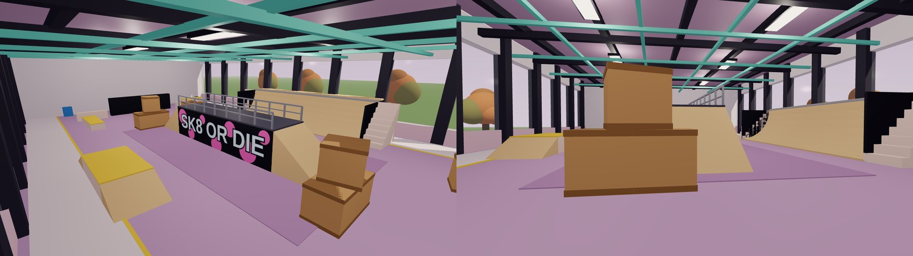
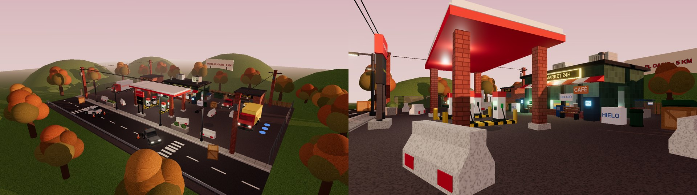
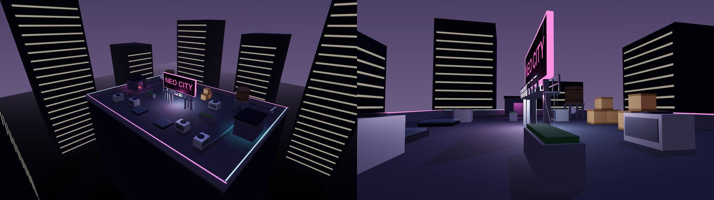
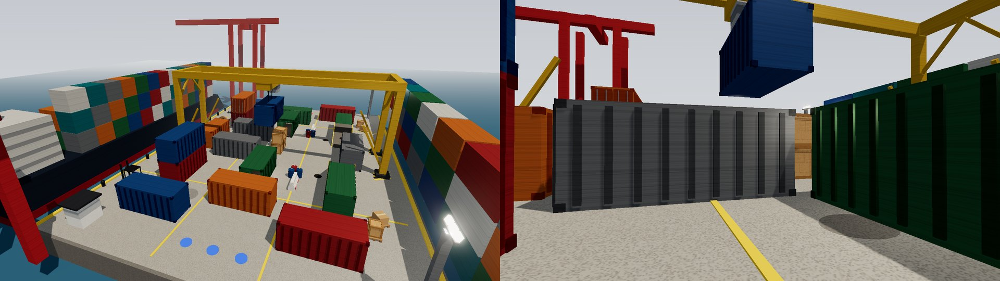
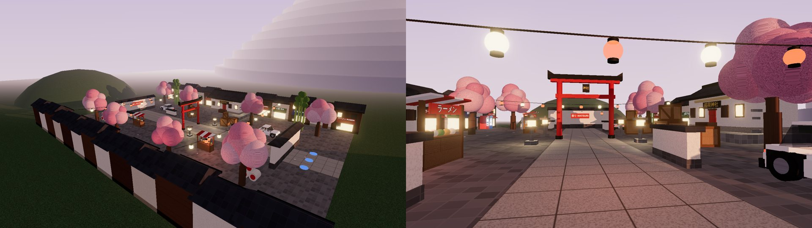
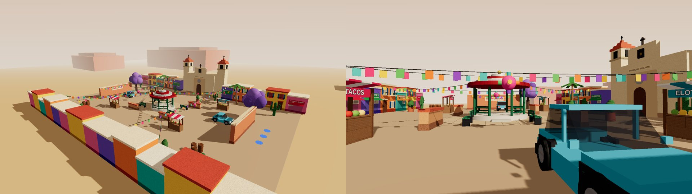
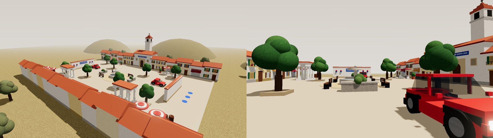
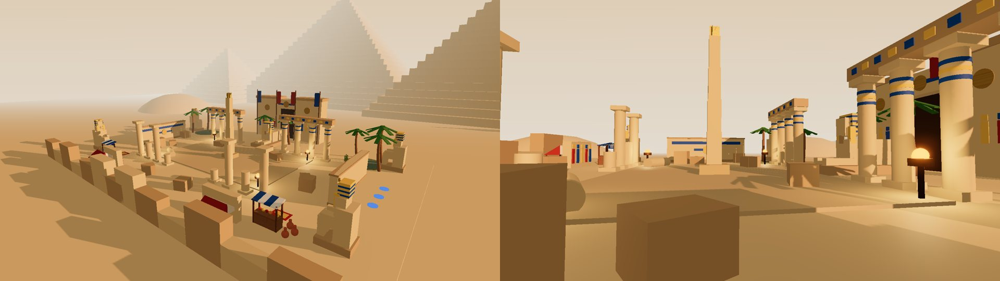
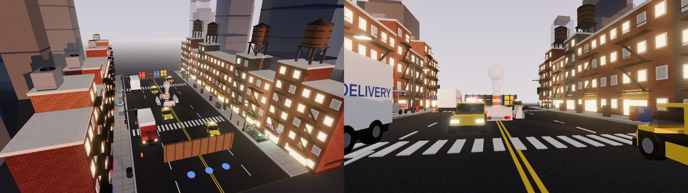
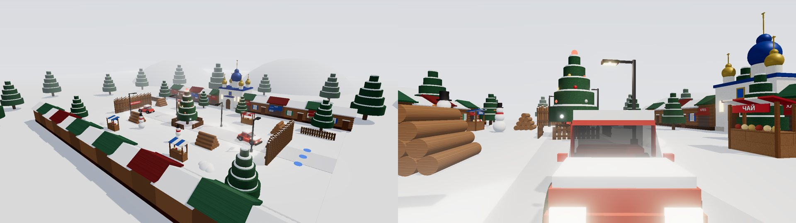
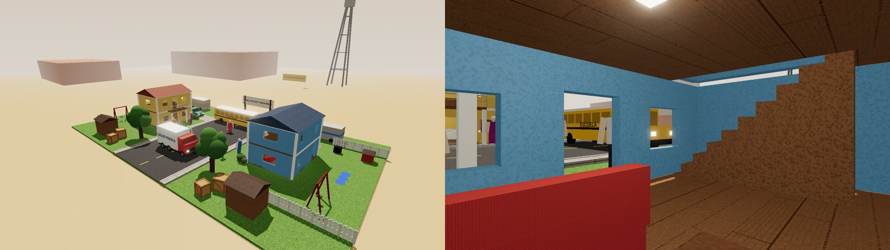
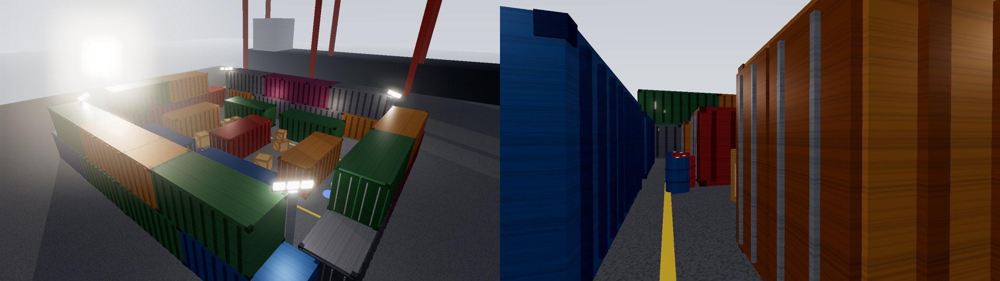
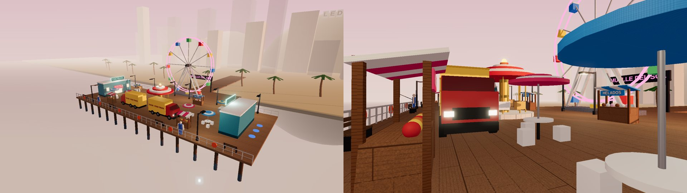
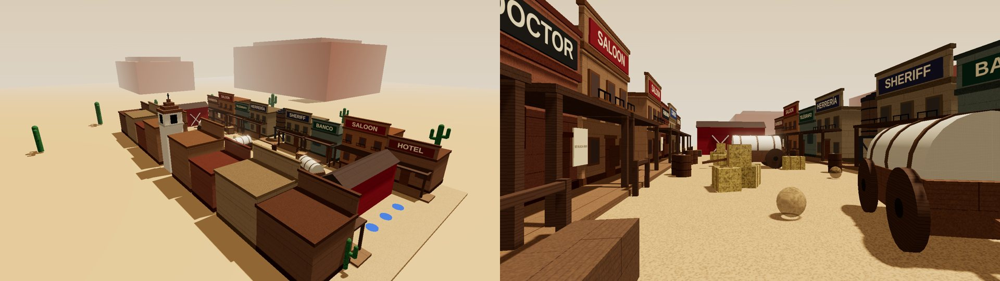
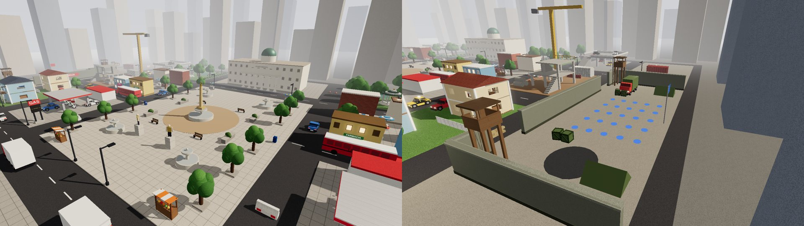

Estas imágenes son una aproximación hecha fuera de Roblox. En Studio, la luz, los materiales y las fuentes se ven mejor.

> **Sobre los mapas de juegos y películas:** están *inspirados* en esos mapas, pero tienen nombres y carteles propios. No usan los nombres ni los logos de Call of Duty, GTA ni de ninguna película, porque Roblox puede retirar los juegos que usan marcas de otros.

## Instalación

### Opción A: barra de comandos (la más fácil)

1. Abre tu juego en Roblox Studio.
2. Abre `ConstruirMapas.luau`, selecciona todo y cópialo.
3. En Studio, ve a **Ver → Barra de comandos**, pega el texto y pulsa **Enter**.
4. **Opcional, pero recomendado:** en el Explorador, selecciona **Lighting** y pon la propiedad **Technology** en **Future**. Así las luces tienen sombras y el neón brilla. Roblox no deja cambiarlo desde scripts, así que hazlo una vez a mano.
5. Se crean tres cosas:
   - `ServerStorage.MapBuilder`, el módulo para cargar mapas.
   - `ServerStorage.MapasDuelo`, con los 15 mapas.
   - `Workspace.MapaActual`, con la Gasolinera colocada para que la veas.
6. Guarda el juego.

Para ver otro mapa, escribe esto en la barra de comandos:
```lua
require(game.ServerStorage.MapBuilder).load("Japon")
```
Los nombres son: `Skatepark`, `Gasolinera`, `Azotea`, `Puerto`, `Japon`, `Mexico`, `Espana`, `Egipto`, `NuevaYork`, `Rusia`, `PuebloNuclear`, `Cargamento`, `Muelle`, `Oeste` y `Ciudad` (sin tildes ni espacios).

### Opción B: Rojo

Añade el módulo a tu `default.project.json`, dentro de `ServerStorage`:
```json
"ServerStorage": {
  "$className": "ServerStorage",
  "MapBuilder": { "$path": "MapasDuelo/MapBuilder" }
}
```
Con Rojo los mapas no se guardan en el juego: se construyen al arrancar el servidor (`DueloMapas.luau` ya lo hace).

## Usarlos en tu juego

```lua
local MapBuilder = require(game.ServerStorage.MapBuilder)
local mapa, spawns = MapBuilder.load("Gasolinera")
-- spawns.A y spawns.B son listas de CFrames: personaje:PivotTo(spawns.A[1])
```

`load` hace tres cosas: quita el mapa anterior de Workspace, coloca el nuevo y aplica su iluminación (hora del día, atmósfera, nubes y color).

`DueloMapas.luau` es un ejemplo listo para tu sistema de rondas. Elige un mapa al azar en el que quepan todos los jugadores y reparte a cada equipo entre sus spawns sin repetir:
```lua
local startDuel = require(game.ServerScriptService.DueloMapas)
startDuel({ jugador1 }, { jugador2 })          -- 1 contra 1: un mapa de duelo al azar
startDuel(equipoAzul, equipoRojo)              -- más de 12 jugadores: la Gran Ciudad
startDuel(equipoAzul, equipoRojo, "Muelle")    -- o el mapa que tú digas
```
Cada mapa guarda cuántos jugadores admite en el atributo `Jugadores`: los mapas de duelo, 12, y la Gran Ciudad, 50.

### Para jugar con 50 personas en la Gran Ciudad

1. **Sube el límite de jugadores del servidor:** en la configuración de tu lugar (Creator Dashboard o, en Studio, Game Settings → Places), pon el máximo de jugadores por servidor en **50**. Roblox pone menos por defecto.
2. **Activa `StreamingEnabled`** en Workspace (recomendado). Así cada jugador carga solo la zona que tiene cerca y el mapa va fluido también en móvil.
3. Cada equipo aparece en su base, en un extremo de la ciudad. Hay 25 spawns por equipo y ninguno se ve desde la base rival.

Cada mapa tiene estas carpetas:
- **Mapa:** suelo, paredes y cobertura.
- **Decoracion:** detalles sin colisión.
- **Spawns:** piezas invisibles con el atributo `Team` = `A` o `B`, tres por equipo.
- **Limites:** paredes invisibles para que nadie se salga del mapa.

## Editar los mapas

- **Retocar a mano:** después de construirlos son piezas normales, así que puedes moverlos, pintarlos o añadir cosas en Studio. Ojo: si vuelves a ejecutar `ConstruirMapas.luau`, se sobrescribe `ServerStorage.MapasDuelo`, así que guarda tus cambios con otro nombre.
- **Cambiar el código:** los mapas están en `MapBuilder/Mapas/*.luau`. Cada pieza es una línea, por ejemplo:
  ```lua
  b:box({ name = "Caja", size = { 5, 5, 5 }, pos = { -30, 2.5, -10 }, color = { 206, 160, 104 }, mat = "WoodPlanks" })
  ```
  Todo lo que va dentro de `b:symmetric(function(b) ... end)` se crea dos veces, una por cada lado. Así el mapa sigue siendo justo para los dos equipos.
- **Usar las piezas prefabricadas:** `MapBuilder/Props.luau` tiene más de 90 objetos listos (coches, taxis, autobuses, camiones, noria, carretas, sacos terreros, torres de vigilancia, maniquíes, farolas, árboles, palmeras, abetos, cactus, contenedores, carteles de neón, guirnaldas, papel picado, farolillos, torii, fuente, quiosco, columnas, obelisco, pirámide, cúpulas, campanario, muñeco de nieve...) para montar mapas nuevos rápido. Por ejemplo, `P.car(b, { x, 0, z }, giro, color)`.
- **Casas en las que se puede entrar:** `P.openHouse` crea una casa de dos plantas con puertas y ventanas abiertas, escalera, balcón y muebles, y `P.wallWithHoles` hace paredes con los huecos que quieras.
- **Casas de cualquier país:** `P.house` crea una casa con ventanas, puerta, tejado y detalles a partir de unas opciones (color, material, tejado plano/a dos aguas/pagoda, contraventanas, balcones con flores, tienda con rótulo, troncos, escaleras de incendios...). `P.houseRow` llena una calle entera alternando estilos. Así puedes hacer un país nuevo cambiando solo colores y textos.
- **Nieve:** la nevada de Rusia usa la textura de partículas por defecto de Roblox. Si quieres copos más bonitos, pon el ID de una textura de copo de nieve en la propiedad `Texture` del emisor `Nieve` (dentro de la pieza `Nevada`).
- **Regenerar el script:** después de cambiar código, ejecuta `python3 build_bundle.py` para volver a crear `ConstruirMapas.luau`.

## Comprobaciones hechas

- El código se ejecutó con una simulación de la API de Roblox. Los 15 mapas se construyen sin errores, y al cambiar de mapa se limpia el anterior y su iluminación.
- Ningún spawn queda dentro de un objeto.
- Ningún spawn tiene visión directa de los spawns rivales, para evitar que se mate a nadie nada más aparecer (en la Gran Ciudad se comprobaron las 625 parejas de spawns).
- `DueloMapas` se probó con 1 contra 1, 3 contra 3, 6 contra 6 y 25 contra 25: elige el mapa adecuado y nadie aparece encima de otro.
- Todos los materiales, fuentes, clases y propiedades que se usan existen en la API oficial de Roblox.
- Los mapas de duelo usan entre 600 y 1.600 piezas, y la Gran Ciudad unas 5.100. Todas están ancladas y la decoración no tiene colisión, así que van ligeros también en móvil.
