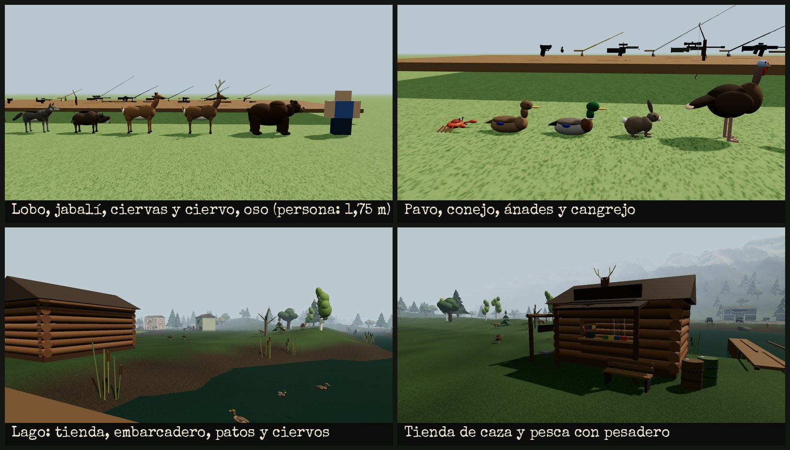
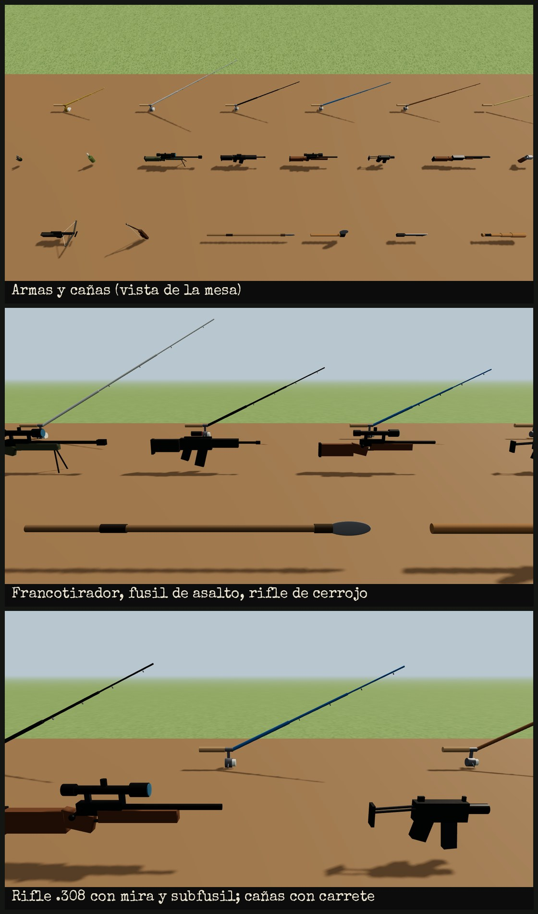

# Mundo Abierto (estilo The Last of Us)

Proyecto **aparte** de los mapas de duelo (`roblox/MapasDuelo`): no comparte archivos con ellos.
Es un mundo de unos 4 × 4 km con relieve, ríos, lagos, playa, montañas nevadas, bosques
y 16 zonas abandonadas unidas por carreteras, con clima que cambia solo, animales salvajes que se
cazan, peces que se pescan, armas, cañas y tiendas de caza y pesca.

## Instalarlo (lugar nuevo de Roblox Studio)

1. Abre un lugar **nuevo** (borra la Baseplate y el terreno que haya).
2. **Ver → Barra de comandos**, pega **todo** el contenido de `ConstruirMundo.luau` y pulsa Enter.
3. Espera de 1 a 3 minutos. En la salida verás el progreso del terreno y al final `[Mundo] Listo`.
4. **Guarda el lugar.**

`ConstruirMundo.luau` lo instala todo: el mundo, el clima y la caza y la pesca. Si solo quieres
actualizar la caza, la pesca y las armas sin rehacer el mundo, pega `InstalarCaza.luau`.

El instalador también activa la iluminación `Future`, los materiales 2022 y `StreamingEnabled`
(con StreamingEnabled cada jugador solo carga lo que tiene cerca, así va fluido aunque el mapa sea enorme).
Para ver la hierba del terreno moverse con el viento: selecciona **Terrain** y activa
`Decoration` en sus propiedades.

## Qué tiene de realista

**Terreno** (vóxeles con texturas reales de Roblox):
- El relieve sale de ruido: colinas suaves, montañas en los bordes con nieve en las cumbres,
  valles de río, playa que baja al mar y una cantera en terrazas.
- El suelo cambia según el sitio: césped corto (`Grass`) en prados y granjas, maleza alta
  (`LeafyGrass`) en bosques y laderas, tierra, barro en las orillas, roca en las pendientes,
  arena en la playa y nieve arriba.
- **Rocas de verdad**: unas 800, esculpidas en el propio terreno con `Rock`, `Slate` y `Basalt`.
  Tienen formas irregulares, no son bolas ni cubos. Algunas están en grupos y otras en los ríos.

**Vegetación** (unas 70.000 piezas, sin colisión salvo los troncos):
- **Abetos** con forma de árbol de navidad: capas de ramas que caen hacia fuera y se acortan
  hacia una punta afilada. Son la mayoría, sobre todo en el norte y en las alturas.
- **Robles** con ramas abiertas y copa irregular de matas aplastadas de varios tonos.
- **Abedules** de tronco blanco con marcas y **árboles secos** con la copa partida.
- **Sotobosque**: helechos, arbustos y abetos jóvenes.
- **Hierba alta** en matas, con hojas en punta, sobre todo donde hay maleza.
- **Juncos con espiga** en las orillas, troncos caídos con musgo y tocones.

**Agua**: es agua del terreno de Roblox, con oleaje y reflejos. El color, la transparencia y las
olas cambian con el clima: clara con sol, turbia con lluvia y tormenta.

**Fuego**:
- Hay hogueras en Villamuro, Ciudadela, Estación, Granjas, Lago Sereno y Colina Alta, y bidones
  ardiendo en los tres campamentos. Tienen llamas reales (`Fire`), humo (`Smoke`), chispas que
  suben y una luz naranja que parpadea.
- El helicóptero estrellado sigue ardiendo y echa una columna de humo negro.

## Climas

Siete climas que cambian solos cada 4–9 minutos con transición suave: **Soleado, Nublado,
Niebla, Viento, Lluvia, Tormenta y Nieve**.
- Cambian la luz, la niebla, las nubes, el color de la imagen, el viento (mueve la hierba y las
  nubes), el oleaje y el color del agua.
- Hay lluvia, nieve y polvo con partículas; bajo techo no llueve encima y los sonidos se apagan.
- En tormenta caen rayos con destello y trueno; el trueno llega más tarde cuanto más lejos cae.
- Con nieve el suelo se va cubriendo de blanco y luego se derrite.

- Forzar un clima: escribe en el chat `/clima lluvia` (lo puede hacer el dueño del juego, y
  cualquiera en Studio).
- Desde otro script: `game.ServerStorage.CambiarClima:Fire("Tormenta")`.
- Ajustes en `ReplicatedStorage.ClimaConfig`: duración, clima inicial, ciclo de día y noche
  (`MinutosPorDia`), y los valores de cada clima.

### Sonidos (importante)

Roblox no trae de serie sonidos de lluvia, truenos, pájaros ni fuego. Solo el **viento** suena
sin hacer nada. Para los demás:

1. En Studio abre **Ver → Caja de herramientas → Audio**.
2. Busca `rain`, `heavy rain`, `thunder`, `birds`, `forest ambience` y `campfire`.
   Mejor los subidos por **Roblox**, que funcionan en cualquier juego.
3. Clic derecho → **Copiar ID del recurso**.
4. Pégalo en `ClimaConfig` → `Config.Sonidos` como `"rbxassetid://NUMERO"`. Los huecos son:

| Hueco | Para qué |
|---|---|
| `Lluvia` | lluvia suave |
| `LluviaFuerte` | aguacero |
| `Pajaros` | pájaros de día |
| `Ambiente` | bosque o grillos |
| `Truenos` | uno o varios truenos |
| `Fuego` | crepitar que se oye al acercarse a cada fuego |

Un hueco vacío simplemente no suena.

## Usar tus propios árboles 3D (opcional, para más realismo)

Las piezas de Roblox no pueden igualar un modelo 3D hecho en Blender. Si quieres árboles aún más
realistas:

1. Busca árboles en la **Caja de herramientas** (por ejemplo `realistic pine tree`).
2. Arrástralos a `ServerStorage → ModelosMundo → Pino` (o `Roble`, `Abedul`, `Muerto`, `Arbusto`).
   El instalador crea esas carpetas y nunca las borra.
3. Vuelve a generar el mundo: en la barra de comandos,
   `require(game.ServerStorage.MundoAbierto).instalar()`.

Cada árbol se coloca apoyado en el suelo, con tamaño y giro al azar, anclado y **sin scripts**:
se les quitan por seguridad, porque algunos modelos de la Toolbox traen virus. Puedes poner varios
modelos por carpeta y se mezclan. Si una carpeta está vacía, se usan los árboles hechos con piezas.

## Caza, pesca y armas

### Lo realista

**Animales con medidas y pesos reales.** Un personaje de Roblox mide 5 studs (1,75 m), así que 1 m son
2,9 studs. Cada ejemplar tiene su propio peso y su tamaño va con él.
- Están hechos con formas orgánicas y llevan articulaciones en caderas, rodillas, cuello y cola.
- Mueven las patas al andar, trotar y galopar.
- Bajan la cabeza para pastar y miran alrededor cuando están parados.
- El ciervo levanta la cola blanca al huir.

| Animal | Dónde vive | Comportamiento |
|---|---|---|
| Ciervo (45–120 kg, los machos con cornamenta) | bosques | huye a 40 m; en parejas |
| Conejo, pavo salvaje | prados y granjas | huyen; los pavos en grupos |
| Jabalí (50–140 kg) | bosques | se defiende si le hieres o te acercas mucho |
| Lobo gris (30–65 kg) | norte y alturas, en manadas de 3 | te caza si te acercas a menos de 35 m |
| Oso pardo (150–380 kg) | montañas | te ataca a menos de 25 m; muy duro |
| Ánade real | lagos y ríos (nada) | huye nadando |
| Cangrejo | playas | huye despacio |

**Cómo te detectan:**
- **Viento.** Si sopla de ti hacia el animal, te huele desde mucho más lejos (×1,6). Si sopla al
  revés, no te huele (×0,7). Es el mismo viento del clima, así que mira hacia dónde se mueve la hierba.
- **Agachado** (tecla C) te detectan a la mitad de distancia; **corriendo** (Mayús) desde más lejos.
- **Los disparos se oyen.** Cada arma hace un ruido distinto (el arco no hace ninguno) y las presas
  que lo oyen salen corriendo.

**Balística y heridas:**
- Las balas, flechas y lanzables vuelan a su velocidad real y caen por la gravedad. Una flecha a
  60 m/s cae casi 1 m a 25 m; una bala .338 a 300 m también cae.
- Una flecha tarda en llegar, así que un animal que corre puede esquivarla.
- El daño depende de **dónde aciertas**:

  | Zona | Daño |
  |---|---|
  | Cabeza | ×2,4 |
  | Cuello | ×1,7 |
  | Pecho (corazón y pulmones) | ×1,5 |
  | Cuerpo | ×0,9 |
  | Patas | ×0,5 |

- Un animal herido **sangra**, huye y deja un **rastro de sangre** en el suelo hasta que cae. Las
  flechas matan sobre todo por desangrado.
- La dispersión aumenta al moverte y baja agachado o apuntando. Las armas tienen retroceso.

**Despiece.** Acércate al animal abatido y mantén **E**: tardas más cuanto más grande es.
- Sacas su carne en kilos (su peso por la parte aprovechable).
- La piel sale Perfecta, Buena, Dañada o Destrozada según el daño recibido.
- La escopeta y las explosiones estropean la piel y la carne.
- Los ciervos machos dan cornamenta, que vale más cuanto más grande es el animal.

### Armas

| Tipo | Armas |
|---|---|
| Cuerpo a cuerpo | Cuchillo de caza, Bate, Machete, Hacha, Lanza |
| Arco y ballesta | Arco recurvo (silencioso, 60 m/s), Ballesta (100 m/s, con mira) |
| Pistolas | Pistola 9 mm (15 balas), Revólver .357 Magnum (6) |
| Escopeta | Escopeta de corredera calibre 12 (9 perdigones por cartucho) |
| Automáticas | Subfusil 9 mm, Fusil de asalto 5,56 |
| Rifles con mira | Rifle de cerrojo .308 (mira 6x), Rifle de francotirador .338 (mira 12x, bípode) |
| Lanzables | Granada (explota a los 3 s), Cóctel molotov (incendia el suelo) |

Cada arma usa su munición y tiene su cargador, su recarga y su cadencia. Todo se cambia en
`ReplicatedStorage.CazaConfig`.

### Pesca y cañas

| Caña | Lanza | Aguanta |
|---|---|---|
| Bambú | 10 m | 4 kg |
| Madera con carrete | 16 m | 8 kg |
| Fibra de vidrio | 24 m | 15 kg |
| Carbono | 32 m | 30 kg |
| Mar (surfcasting) | 45 m | 70 kg |
| Curricán | 50 m | 220 kg |

1. Con la caña, **clic** donde quieras lanzar: un río, un lago o el mar.
2. Espera a que piquen. Con lluvia o nublado pican antes.
3. Cuando el corcho se hunde, **clic** para clavar: tienes poco más de un segundo.
4. Después **mantén pulsado** para recoger sedal y **suelta** cuando el pez tire fuerte o la tensión
   esté en rojo:
   - si la tensión llega al máximo, **se rompe el sedal**;
   - si le das demasiado sedal, el pez se escapa;
   - un pez mucho más pesado de lo que aguanta tu caña la rompe nada más clavarlo.

Hay 13 peces con pesos reales (la mayoría salen pequeños) y cada agua tiene los suyos:

| Agua | Peces |
|---|---|
| Río y lago | perca, trucha, carpa (solo lago), lucio, salmón (solo río), siluro y esturión (legendario) |
| Mar | caballa, lubina, bacalao, atún rojo (hasta 400 kg) y pez espada |

Y alguna bota vieja. La mochila guarda tu récord de cada especie.

### Tiendas, dinero y controles

Hay tres **tiendas de caza y pesca**:
- junto al **Lago Sereno**, con embarcadero para pescar;
- en **Villamuro**;
- en la **Ciudadela**.

Para comprar armas, cañas y munición, pulsa **E** en el mostrador. Cada arma de fuego trae una caja de
balas. Para vender todo lo de la mochila, pulsa **F** en el **pesadero**. Empiezas con 150 $, un
cuchillo, el arco con 13 flechas y la caña de bambú. El dinero se ve en la lista de jugadores. Si el
juego está publicado se guardan entre partidas el dinero, el equipo, la munición, la mochila y los récords.

| Control | Qué hace |
|---|---|
| Clic | disparar, golpear, lanzar o pescar (mantén con las automáticas) |
| Clic derecho | apuntar; los rifles muestran la mira telescópica |
| R | recargar |
| C | agacharse |
| Mayús | correr |
| B | mochila |
| E | despellejar o abrir la tienda |
| F | vender en el pesadero |

Con un arma a distancia la cámara se pone por encima del hombro. En móvil hay botones en pantalla.

**Opciones** en `CazaConfig`:
- `DanoEntreJugadores` (por defecto solo se daña a los animales);
- la cantidad de cada animal, los precios y las distancias de detección;
- `GuardarDatos`.

**Sonidos de las armas y los animales**: igual que el clima, pega IDs de la Caja de herramientas en
`CazaConfig.Sonidos`. Hay huecos para:
- cada arma y la recarga;
- el impacto;
- la picada, el carrete, la captura y el sedal roto;
- la caja registradora;
- cada animal.

Ya vienen de serie los golpes cuerpo a cuerpo, el lanzamiento y el chapoteo del anzuelo.

## Zonas

Granjas, Villamuro (fortaleza), Comisaría, Lago Sereno, Penal, Zona Prohibida, Motel,
Megatienda, Estación, Antena, Condado (ciudad en ruinas), Cantera, Colina Alta, Ciudadela
(zona de cuarentena), Ladera y Refugio. Cada una tiene su punto de aparición (16 en total) y el
suelo de cada zona tiene su propio material.

## Archivos

| Archivo | Qué es |
|---|---|
| `ConstruirMundo.luau` | todo en uno para pegar en la barra de comandos |
| `src/MundoAbierto/` | `ServerStorage.MundoAbierto`: módulo principal |
| `src/MundoAbierto/Motor.luau` | constructor de piezas, fuego y elipsoides |
| `src/MundoAbierto/Piezas.luau` | objetos prefabricados: casas, coches, hogueras… |
| `src/MundoAbierto/Datos.luau` | costa, ríos, lagos, carreteras y zonas |
| `src/MundoAbierto/Terreno.luau` | relieve, suelo y rocas en vóxeles |
| `src/MundoAbierto/Vegetacion.luau` | árboles y plantas |
| `src/MundoAbierto/Zonas/` | una zona por archivo |
| `src/Clima/` | `ClimaConfig` (ReplicatedStorage), `ClimaServidor` (ServerScriptService) y `ClimaCliente` (StarterPlayerScripts) |
| `src/Caza/CazaConfig.luau` | `ReplicatedStorage.CazaConfig`: animales, armas, cañas, peces, precios y sonidos |
| `src/Caza/CazaServidor/` | `ServerScriptService.CazaServidor`: modelos, animales, armas, pesca y economía |
| `src/Caza/CazaCliente/` | `StarterPlayerScripts.CazaCliente`: controles, pantalla, efectos y animación de los animales |
| `InstalarCaza.luau` | solo la caza, la pesca y las armas (para instalarlas o actualizarlas) |
| `default.project.json` | para usarlo con Rojo (`IniciarMundo` construye el mundo si no está guardado) |
| `build_bundle.py` | regenera `ConstruirMundo.luau` a partir de `src/` |

## Comprobado

Todo se probó fuera de Roblox Studio, con una simulación de la API de Roblox:
- Se construye el mundo entero: unas 87.000 piezas (con las tres tiendas), 16 puntos de aparición
  y 0 problemas.
  Ninguna pieza queda enterrada o bajo el agua, y las zonas quedan llanas.
- Se escribe todo el terreno: 256 bloques y 19 millones de vóxeles, con las rocas, sin errores
  de formato.
- Los 7 climas, los rayos, el comando `/clima` y los modelos propios funcionan en la simulación:
  los modelos quedan en el suelo, escalados y sin scripts.
- Los nombres de la API se comprobaron contra las definiciones de tipos de Roblox, y todos los
  archivos compilan con el compilador oficial de Luau.
- **Caza y pesca**: se simuló el servidor y el cliente juntos, con un jugador, red, reloj y rayos
  contra el terreno real:
  - aparecen 136 animales, cada uno en su sitio: patos en el agua, cangrejos en la arena y ninguno en
    los pueblos;
  - un tiro de rifle al pecho abate un ciervo a 67 m;
  - una flecha bien compensada hiere a un ciervo, que huye 40 m sangrando, deja rastro y cae;
  - los lobos atacan;
  - una granada mata a tres pavos;
  - el viento decide si un ciervo te huele;
  - en 12 lanzamientos de pesca hubo 11 capturas y un sedal roto;
  - se compra y se vende en la tienda, sin errores.

Las imágenes de `previews/` son una **aproximación** hecha con otro motor (three.js). En Roblox se
verá con sus propios materiales, sombras y efectos. **No se ha probado dentro de Roblox Studio**:
si algo falla, copia el error de la ventana de salida.
