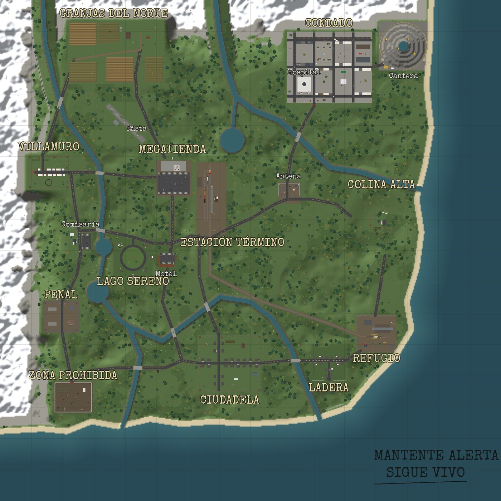
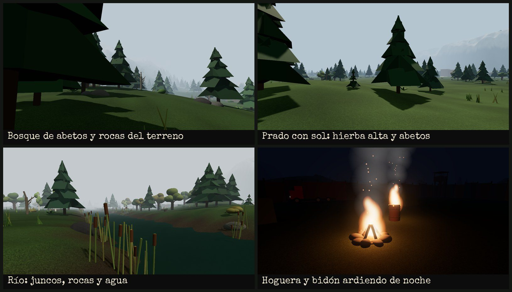
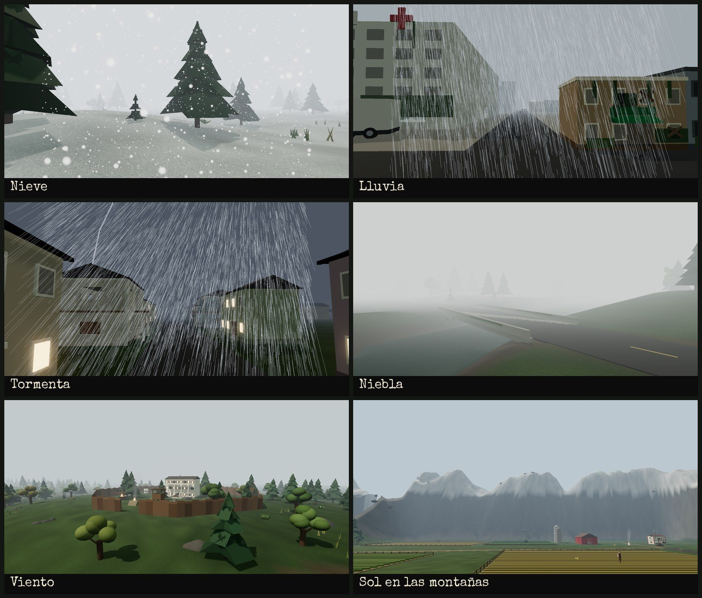

# Mundo Abierto (estilo The Last of Us)

Proyecto **aparte** de los mapas de duelo (`roblox/MapasDuelo`): no comparte archivos con ellos.
Es un mundo de unos 4 × 4 km con relieve, ríos, lagos, playa, montañas nevadas, bosques
y 16 zonas abandonadas unidas por carreteras, con clima que cambia solo.

## Instalarlo (lugar nuevo de Roblox Studio)

1. Abre un lugar **nuevo** (borra la Baseplate y el terreno que haya).
2. **Ver → Barra de comandos**, pega **todo** el contenido de `ConstruirMundo.luau` y pulsa Enter.
3. Espera de 1 a 3 minutos. En la salida verás el progreso del terreno y al final `[Mundo] Listo`.
4. **Guarda el lugar.**

El instalador también activa la iluminación `Future`, los materiales 2022 y `StreamingEnabled`
(con StreamingEnabled cada jugador solo carga lo que tiene cerca, así va fluido aunque el mapa sea enorme).
Para ver la hierba del terreno moverse con el viento: selecciona **Terrain** y activa
`Decoration` en sus propiedades.

## Qué tiene de realista

**Terreno** (vóxeles con texturas reales de Roblox):
- El relieve sale de ruido: colinas suaves, montañas en los bordes con nieve en las cumbres,
  valles de río, playa que baja al mar y una cantera en terrazas.
- El suelo cambia según el sitio: césped corto (`Grass`) en prados y granjas, maleza alta
  (`LeafyGrass`) en bosques y laderas, tierra, barro en las orillas, roca en las pendientes,
  arena en la playa y nieve arriba.
- **Rocas de verdad**: unas 800, esculpidas en el propio terreno con `Rock`, `Slate` y `Basalt`.
  Tienen formas irregulares, no son bolas ni cubos. Algunas están en grupos y otras en los ríos.

**Vegetación** (unas 70.000 piezas, sin colisión salvo los troncos):
- **Abetos** con forma de árbol de navidad: capas de ramas que caen hacia fuera y se acortan
  hacia una punta afilada. Son la mayoría, sobre todo en el norte y en las alturas.
- **Robles** con ramas abiertas y copa irregular de matas aplastadas de varios tonos.
- **Abedules** de tronco blanco con marcas y **árboles secos** con la copa partida.
- **Sotobosque**: helechos, arbustos y abetos jóvenes.
- **Hierba alta** en matas, con hojas en punta, sobre todo donde hay maleza.
- **Juncos con espiga** en las orillas, troncos caídos con musgo y tocones.

**Agua**: es agua del terreno de Roblox, con oleaje y reflejos. El color, la transparencia y las
olas cambian con el clima: clara con sol, turbia con lluvia y tormenta.

**Fuego**:
- Hay hogueras en Villamuro, Ciudadela, Estación, Granjas, Lago Sereno y Colina Alta, y bidones
  ardiendo en los tres campamentos. Tienen llamas reales (`Fire`), humo (`Smoke`), chispas que
  suben y una luz naranja que parpadea.
- El helicóptero estrellado sigue ardiendo y echa una columna de humo negro.

## Climas

Siete climas que cambian solos cada 4–9 minutos con transición suave: **Soleado, Nublado,
Niebla, Viento, Lluvia, Tormenta y Nieve**.
- Cambian la luz, la niebla, las nubes, el color de la imagen, el viento (mueve la hierba y las
  nubes), el oleaje y el color del agua.
- Hay lluvia, nieve y polvo con partículas; bajo techo no llueve encima y los sonidos se apagan.
- En tormenta caen rayos con destello y trueno; el trueno llega más tarde cuanto más lejos cae.
- Con nieve el suelo se va cubriendo de blanco y luego se derrite.

- Forzar un clima: escribe en el chat `/clima lluvia` (lo puede hacer el dueño del juego, y
  cualquiera en Studio).
- Desde otro script: `game.ServerStorage.CambiarClima:Fire("Tormenta")`.
- Ajustes en `ReplicatedStorage.ClimaConfig`: duración, clima inicial, ciclo de día y noche
  (`MinutosPorDia`), y los valores de cada clima.

### Sonidos (importante)

Roblox no trae de serie sonidos de lluvia, truenos, pájaros ni fuego. Solo el **viento** suena
sin hacer nada. Para los demás:

1. En Studio abre **Ver → Caja de herramientas → Audio**.
2. Busca `rain`, `heavy rain`, `thunder`, `birds`, `forest ambience` y `campfire`.
   Mejor los subidos por **Roblox**, que funcionan en cualquier juego.
3. Clic derecho → **Copiar ID del recurso**.
4. Pégalo en `ClimaConfig` → `Config.Sonidos` como `"rbxassetid://NUMERO"`. Los huecos son:

| Hueco | Para qué |
|---|---|
| `Lluvia` | lluvia suave |
| `LluviaFuerte` | aguacero |
| `Pajaros` | pájaros de día |
| `Ambiente` | bosque o grillos |
| `Truenos` | uno o varios truenos |
| `Fuego` | crepitar que se oye al acercarse a cada fuego |

Un hueco vacío simplemente no suena.

## Usar tus propios árboles 3D (opcional, para más realismo)

Las piezas de Roblox no pueden igualar un modelo 3D hecho en Blender. Si quieres árboles aún más
realistas:

1. Busca árboles en la **Caja de herramientas** (por ejemplo `realistic pine tree`).
2. Arrástralos a `ServerStorage → ModelosMundo → Pino` (o `Roble`, `Abedul`, `Muerto`, `Arbusto`).
   El instalador crea esas carpetas y nunca las borra.
3. Vuelve a generar el mundo: en la barra de comandos,
   `require(game.ServerStorage.MundoAbierto).instalar()`.

Cada árbol se coloca apoyado en el suelo, con tamaño y giro al azar, anclado y **sin scripts**:
se les quitan por seguridad, porque algunos modelos de la Toolbox traen virus. Puedes poner varios
modelos por carpeta y se mezclan. Si una carpeta está vacía, se usan los árboles hechos con piezas.

## Zonas

Granjas, Villamuro (fortaleza), Comisaría, Lago Sereno, Penal, Zona Prohibida, Motel,
Megatienda, Estación, Antena, Condado (ciudad en ruinas), Cantera, Colina Alta, Ciudadela
(zona de cuarentena), Ladera y Refugio. Cada una tiene su punto de aparición (16 en total) y el
suelo de cada zona tiene su propio material.

## Archivos

| Archivo | Qué es |
|---|---|
| `ConstruirMundo.luau` | todo en uno para pegar en la barra de comandos |
| `src/MundoAbierto/` | `ServerStorage.MundoAbierto`: módulo principal |
| `src/MundoAbierto/Motor.luau` | constructor de piezas, fuego y elipsoides |
| `src/MundoAbierto/Piezas.luau` | objetos prefabricados: casas, coches, hogueras… |
| `src/MundoAbierto/Datos.luau` | costa, ríos, lagos, carreteras y zonas |
| `src/MundoAbierto/Terreno.luau` | relieve, suelo y rocas en vóxeles |
| `src/MundoAbierto/Vegetacion.luau` | árboles y plantas |
| `src/MundoAbierto/Zonas/` | una zona por archivo |
| `src/Clima/` | `ClimaConfig` (ReplicatedStorage), `ClimaServidor` (ServerScriptService) y `ClimaCliente` (StarterPlayerScripts) |
| `default.project.json` | para usarlo con Rojo (`IniciarMundo` construye el mundo si no está guardado) |
| `build_bundle.py` | regenera `ConstruirMundo.luau` a partir de `src/` |

## Comprobado

Todo se probó fuera de Roblox Studio, con una simulación de la API de Roblox:
- Se construye el mundo entero: 86.500 piezas, 16 puntos de aparición y 0 problemas.
  Ninguna pieza queda enterrada o bajo el agua, y las zonas quedan llanas.
- Se escribe todo el terreno: 256 bloques y 19 millones de vóxeles, con las rocas, sin errores
  de formato.
- Los 7 climas, los rayos, el comando `/clima` y los modelos propios funcionan en la simulación:
  los modelos quedan en el suelo, escalados y sin scripts.
- Los nombres de la API se comprobaron contra las definiciones de tipos de Roblox.

Las imágenes de `previews/` son una **aproximación** hecha con otro motor (three.js). En Roblox se
verá con sus propios materiales, sombras y efectos. **No se ha probado dentro de Roblox Studio**:
si algo falla, copia el error de la ventana de salida.
